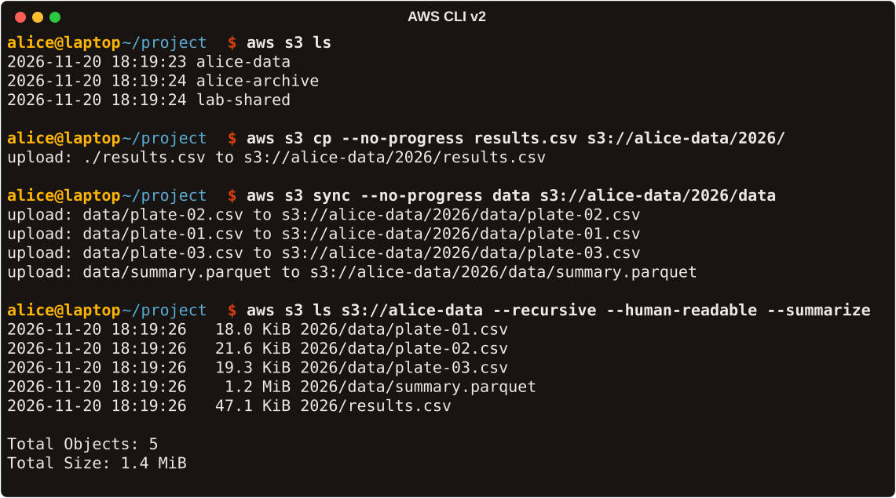
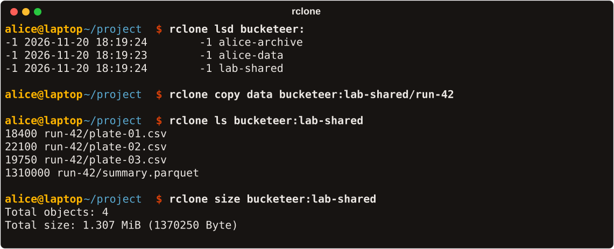
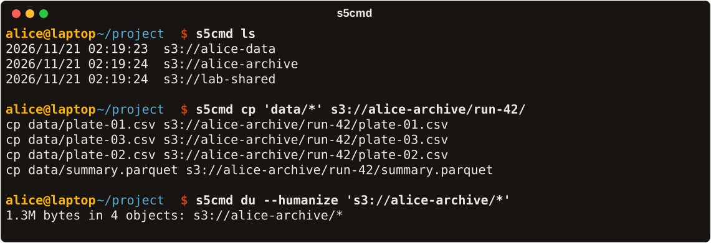
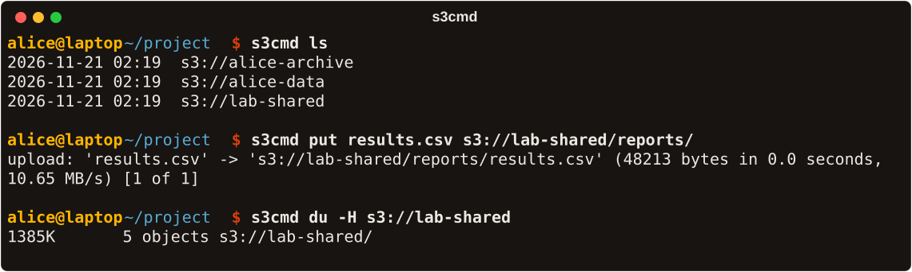
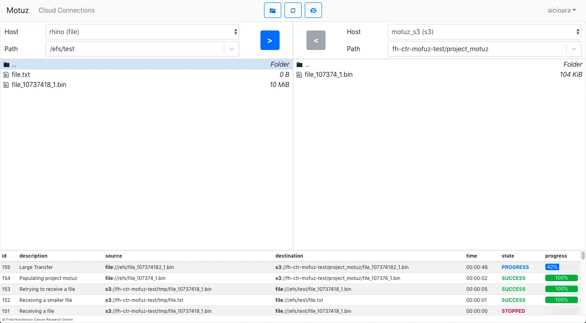

<div class="osu-hero" markdown>
<span class="osu-kicker">For users</span>

# S3 clients

Bucketeer gives you an S3 account, keys and buckets. To move files in and out, you use an
S3 client. This page compares 22 of them, shows the ones we recommend, and gives the settings
that connect each one to our Ceph cluster.
</div>

## Before you start

1. Log in to Bucketeer and open **Set up this computer**. Copy the one-line command for your
   system and run it. It writes the profile `s3-onprem` to `~/.aws/config` and
   `~/.aws/credentials`.
2. Most command-line tools below read that profile directly. For graphical tools, you need
   three values: the **endpoint** (for example `https://s3.example.edu`), your **access
   key** and your **secret key**. Turn on **Advanced** in Bucketeer to see them on the
   Credentials card.
3. Use **virtual-host style** addressing: the bucket name goes in front of the endpoint
   host, as in `https://my-bucket.s3.example.edu`. This is why bucket names have no dots.
   The region can be any
   value (for example `us-east-1`); Ceph ignores it, but most tools need one.

!!! warning "Keep your secret key secret"
    The secret key is a password. Do not paste it into chat, email or a shared script.
    If you think someone saw it, rotate the key in Bucketeer (Advanced, Credentials).

## Our picks

<div class="osu-cards" markdown>
<div class="osu-card" markdown>
<span class="osu-tag">Desktop app</span>

### Cyberduck

Free, Windows and Mac. Drag and drop, easy to set up. The best start for most people.
[Set up](#setup-cyberduck)
</div>
<div class="osu-card blue" markdown>
<span class="osu-tag">Command line</span>

### AWS CLI v2

The reference tool. Bucketeer's setup command configures it for you.
[Examples](#setup-aws-cli)
</div>
<div class="osu-card pine" markdown>
<span class="osu-tag">Sync and mount</span>

### rclone

Sync folders, mount a bucket as a drive, check checksums. One tool for everything.
[Examples](#setup-rclone)
</div>
<div class="osu-card gold" markdown>
<span class="osu-tag">Web app</span>

### Motuz

Large transfers between file systems and the cloud, from the browser, with checksums.
[Read more](#setup-motuz)
</div>
</div>

## All clients compared

<span class="yes">✓</span> works, (✓) limited or beta, <span class="no">–</span> not available.

<div class="osu-table" markdown>

| # | Tool | Type | Win | Mac | Linux | Cost | Notes |
|--:|---|---|:-:|:-:|:-:|---|---|
| 1 | **[Cyberduck](https://cyberduck.io/)** | <span class="osu-pill">GUI</span> | <span class="yes">✓</span> | <span class="yes">✓</span> | <span class="no">–</span> | Free (OSS) | The usual default. Endpoint profiles are easy to hand out to users. Weaker for bulk transfers. |
| 2 | **[Brows3](https://github.com/rgcsekaraa/brows3)** | <span class="osu-pill">GUI</span> | <span class="yes">✓</span> | <span class="yes">✓</span> | <span class="yes">✓</span> | Free (MIT) | Rust and Tauri. Has a compatibility mode for custom endpoints, works without ListBuckets permission, and keeps credentials in the OS keychain. Young project. |
| 3 | **[S3 Browser](https://s3browser.com/)** (NetSDK) | <span class="osu-pill">GUI</span> | <span class="yes">✓</span> | <span class="no">–</span> | <span class="no">–</span> | Free personal / Pro | Strong UI for ACLs, policies, versioning and lifecycle. |
| 4 | **[MSP360 Explorer](https://www.msp360.com/explorer/)** (formerly CloudBerry) | <span class="osu-pill">GUI</span> | <span class="yes">✓</span> | (✓) | <span class="no">–</span> | Free / PRO about $60 one-time | Dual-pane layout with policy and lifecycle support. Free edition caps objects at 5 GB. Vendor now focuses on backup. |
| 5 | **[WinSCP](https://winscp.net/)** | <span class="osu-pill">GUI</span> | <span class="yes">✓</span> | <span class="no">–</span> | <span class="no">–</span> | Free (OSS) | Familiar to SFTP users. Basic S3 support. |
| 6 | **[Transmit](https://panic.com/transmit/)** (Panic) | <span class="osu-pill">GUI</span> | <span class="no">–</span> | <span class="yes">✓</span> | <span class="no">–</span> | Paid | The most polished Mac client. |
| 7 | **[FileZilla Pro](https://filezillapro.com/)** | <span class="osu-pill">GUI</span> | <span class="yes">✓</span> | <span class="yes">✓</span> | <span class="yes">✓</span> | Paid annual | Many protocols in one app. S3 support is only in Pro. |
| 8 | **[KIO S3](https://invent.kde.org/network/kio-s3)** | <span class="osu-pill">GUI</span> | <span class="no">–</span> | <span class="no">–</span> | <span class="yes">✓</span> | Free | S3 inside KDE apps such as Dolphin. |
| 9 | **[RcloneView](https://rcloneview.com/)** / Rclone GUI | <span class="osu-pill">GUI</span> | <span class="yes">✓</span> | <span class="yes">✓</span> | <span class="yes">✓</span> | Free / freemium | A front end for rclone. |
| 10 | **[Mountain Duck](https://mountainduck.io/)** | <span class="osu-pill mount">Desktop mount</span> | <span class="yes">✓</span> | <span class="yes">✓</span> | <span class="no">–</span> | Paid | Cyberduck's drive-mount sibling. Has offline sync and is good with custom endpoints. |
| 11 | **[CloudMounter](https://cloudmounter.net/)** | <span class="osu-pill mount">Desktop mount</span> | <span class="yes">✓</span> | <span class="yes">✓</span> | <span class="no">–</span> | Paid | Mounts S3 and consumer clouds side by side. Finder integration and optional encryption. |
| 12 | **[ExpanDrive](https://www.expandrive.com/)** | <span class="osu-pill mount">Desktop mount + browser</span> | <span class="yes">✓</span> | <span class="yes">✓</span> | <span class="yes">✓</span> | Free / paid | One of the few polished mount tools on all three OSes. |
| 13 | **[rclone](https://rclone.org/)** | <span class="osu-pill cli">CLI + mount</span> | <span class="yes">✓</span> | <span class="yes">✓</span> | <span class="yes">✓</span> | Free (OSS) | Most versatile: sync, mount, crypt, checksums, 70+ backends. |
| 14 | **[s5cmd](https://github.com/peak/s5cmd)** | <span class="osu-pill cli">CLI</span> | <span class="yes">✓</span> | <span class="yes">✓</span> | <span class="yes">✓</span> | Free (OSS) | Fastest for bulk and many-small-object work. Good for benchmarking. |
| 15 | **[AWS CLI v2](https://aws.amazon.com/cli/)** | <span class="osu-pill cli">CLI</span> | <span class="yes">✓</span> | <span class="yes">✓</span> | <span class="yes">✓</span> | Free | The reference implementation with full API coverage. Use `--endpoint-url` for other S3 stores. |
| 16 | **[s3cmd](https://s3tools.org/s3cmd)** | <span class="osu-pill cli">CLI</span> | <span class="yes">✓</span> | <span class="yes">✓</span> | <span class="yes">✓</span> | Free (OSS) | Old but handy for policies and lifecycle. Common in Ceph docs. |
| 17 | **[MinIO mc](https://github.com/minio/mc)** | <span class="osu-pill cli">CLI</span> | <span class="yes">✓</span> | <span class="yes">✓</span> | <span class="yes">✓</span> | Free (AIStor license) | Nice UX. The community edition is archived, so check the license first. |
| 18 | **[Mountpoint for S3](https://github.com/awslabs/mountpoint-s3)** | <span class="osu-pill mount">FUSE mount</span> | <span class="no">–</span> | <span class="no">–</span> | <span class="yes">✓</span> | Free (OSS) | AWS's own mount tool. Fast for reads, limited write semantics. |
| 19 | **[s3fs-fuse](https://github.com/s3fs-fuse/s3fs-fuse)** | <span class="osu-pill mount">FUSE mount</span> | <span class="no">–</span> | <span class="yes">✓</span> | <span class="yes">✓</span> | Free (OSS) | Mature and widely packaged. Slower than the alternatives. |
| 20 | **[goofys](https://github.com/kahing/goofys)** | <span class="osu-pill mount">FUSE mount</span> | <span class="no">–</span> | <span class="yes">✓</span> | <span class="yes">✓</span> | Free (OSS) | Fast but not fully POSIX. Development has slowed. |
| 21 | **[Amazon S3 Files](https://aws.amazon.com/s3/)** | <span class="osu-pill mount">Managed NFS (AWS)</span> | <span class="no">–</span> | <span class="no">–</span> | ✓\* | Pay per use | NFS v4.1 mount on AWS compute only (EC2, EKS, ECS, Lambda, Batch). No desktop mounts, and AWS S3 only, so no Ceph RGW. |
| 22 | **[Motuz](https://dirkpetersen.github.io/motuz)** | <span class="osu-pill">Web app</span> | <span class="yes">✓</span> | <span class="yes">✓</span> | <span class="yes">✓</span> | Free (MIT) | Runs on a server; you use it in the browser. Large transfers between on-premise storage and S3, with checksum checks. |

</div>

\* AWS compute only.

!!! note "A bucket is not a disk"
    Mount tools (Mountain Duck, rclone mount, s3fs and others) make a bucket look like a
    folder, but S3 has no real folders, no file locks and no in-place edits. Use them to
    browse and to copy files. Do not run databases, mailboxes or many small edits on them.

## Command-line clients

All screenshots below are real output of each tool against an S3 test server, with the
settings shown next to them.

### AWS CLI v2 { #setup-aws-cli }

The AWS CLI is the reference tool, and the base for the others: rclone, s5cmd and many
scripts can read its profile. Bucketeer uses the profile name `s3-onprem`, so it never
touches your other AWS settings. (Earlier versions used `bucketeer`; an existing
`[bucketeer]` section is left alone, so switch your scripts to `s3-onprem` and then remove
it.)

**Step 1. Install the AWS CLI v2.**

=== "Windows"

    Download and run the installer from
    [aws.amazon.com/cli](https://aws.amazon.com/cli/), or in PowerShell:

    ```powershell
    winget install Amazon.AWSCLI
    ```

=== "macOS"

    ```bash
    brew install awscli
    ```

    Or use the `.pkg` installer from [aws.amazon.com/cli](https://aws.amazon.com/cli/).

=== "Linux"

    ```bash
    curl -sSL "https://awscli.amazonaws.com/awscli-exe-linux-x86_64.zip" -o awscliv2.zip
    unzip -q awscliv2.zip && ./aws/install --install-dir ~/.local/aws-cli --bin-dir ~/.local/bin
    ```

Check it with `aws --version`. It must say `aws-cli/2.x`.

**Step 2. Create the profile `s3-onprem`.** The easy way: in Bucketeer, open **Set up
this computer**, create the command for your system and run it. It writes both files and
tests the connection.

If you cannot run the setup command, make the profile by hand. Turn on **Advanced** in
Bucketeer to see your endpoint, access key and secret key, then run these lines (they work
the same in a terminal and in PowerShell):

```bash
aws configure set aws_access_key_id     <your access key> --profile s3-onprem
aws configure set aws_secret_access_key <your secret key> --profile s3-onprem
aws configure set region us-east-1                        --profile s3-onprem
aws configure set endpoint_url https://s3.example.edu     --profile s3-onprem
aws configure set request_checksum_calculation when_required --profile s3-onprem
aws configure set response_checksum_validation when_required --profile s3-onprem
aws configure set s3.addressing_style virtual             --profile s3-onprem
```

**Step 3. Check it.**

```bash
aws configure list --profile s3-onprem   # shows where each value comes from
aws --profile s3-onprem s3 ls            # lists your buckets
```

**Step 4. Use `s3-onprem` without typing `--profile` each time** (optional):

=== "bash / zsh"

    ```bash
    echo 'export AWS_PROFILE=s3-onprem' >> ~/.bashrc   # ~/.zshrc on a Mac
    ```

=== "PowerShell"

    ```powershell
    [Environment]::SetEnvironmentVariable("AWS_PROFILE", "s3-onprem", "User")
    ```

Open a new terminal after this.

<figure class="osu-shot" markdown>

<figcaption>List buckets, upload one file, sync a folder, then list it all.</figcaption>
</figure>

=== "Everyday commands"

    ```bash
    aws s3 ls                                   # your buckets
    aws s3 ls s3://my-bucket/ --recursive       # files in a bucket
    aws s3 cp results.csv s3://my-bucket/2026/  # upload one file
    aws s3 cp s3://my-bucket/2026/results.csv . # download one file
    aws s3 sync ./data s3://my-bucket/data      # upload only what changed
    aws s3 sync s3://my-bucket/data ./data      # and back
    ```

=== "~/.aws/config"

    ```ini
    [profile s3-onprem]
    region = us-east-1
    endpoint_url = https://s3.example.edu
    request_checksum_calculation = when_required
    response_checksum_validation = when_required
    s3 =
      addressing_style = virtual
    ```

=== "~/.aws/credentials"

    ```ini
    [s3-onprem]
    aws_access_key_id = <your access key>
    aws_secret_access_key = <your secret key>
    ```

!!! tip "Checksum errors with new AWS tools"
    New AWS CLI and SDK versions send CRC checksums that some Ceph versions refuse. The two
    `when_required` lines prevent that. The setup command adds them for you.

### rclone { #setup-rclone }

The most versatile tool: sync, copy with checksums, mount, encrypt. rclone can use the AWS
profile `s3-onprem`, so your keys stay in one place: when you rotate a key and run the
setup command again, rclone uses the new key at once.

**Step 1. Install rclone** from [rclone.org/install](https://rclone.org/install/)
(`winget install Rclone.Rclone`, `brew install rclone`, or
`sudo -v ; curl https://rclone.org/install.sh | sudo bash`). Check it with
`rclone version`.

**Step 2. Make the profile `s3-onprem` for the AWS CLI first** ([see above](#setup-aws-cli)).

**Step 3. Create the rclone remote `bucketeer` from that profile.** This one command
copies the endpoint from your AWS config, so you do not need to type it:

=== "bash / zsh"

    ```bash
    rclone config create bucketeer s3 provider=Ceph env_auth=true profile=s3-onprem \
      force_path_style=false endpoint="$(aws configure get endpoint_url --profile s3-onprem)"
    ```

=== "PowerShell"

    ```powershell
    $ep = aws configure get endpoint_url --profile s3-onprem
    rclone config create bucketeer s3 provider=Ceph env_auth=true profile=s3-onprem `
      force_path_style=false endpoint=$ep
    ```

=== "Resulting rclone.conf"

    ```ini
    [bucketeer]
    type = s3
    provider = Ceph
    env_auth = true
    profile = s3-onprem
    endpoint = https://s3.example.edu
    force_path_style = false
    ```

    `env_auth = true` and `profile = s3-onprem` tell rclone to read the access key and
    secret key from `~/.aws/credentials`. The file holds no secret. Find it with
    `rclone config file`.

**Step 4. Check it:** `rclone lsd bucketeer:` lists your buckets. Paths are
`bucketeer:<bucket>/<folder>`.

<figure class="osu-shot" markdown>

<figcaption>List buckets, copy a folder, list and size the result.</figcaption>
</figure>

```bash
rclone lsd bucketeer:                          # buckets
rclone copy ./data bucketeer:my-bucket/data -P # copy with progress
rclone sync ./data bucketeer:my-bucket/data    # make the target equal the source
rclone check ./data bucketeer:my-bucket/data   # compare checksums
rclone mount bucketeer:my-bucket ~/my-bucket   # mount (needs FUSE, or WinFsp on Windows)
```

**rclone with a GUI.** rclone 1.76 and later have a built-in web GUI. It uses the same
`bucketeer` remote. Run the command below, and rclone opens its GUI in your browser,
already logged in; it listens on your own computer only. Open **Explorer**, then
**bucketeer** under Remotes, to browse, upload and download.

```bash
rclone gui
```

<figure class="osu-shot" markdown>


<figcaption>The rclone GUI (<code>rclone gui</code>) browsing <code>bucketeer:alice-data/2026/run-42</code>.</figcaption>
</figure>

!!! danger "`rclone sync` deletes"
    `sync` deletes files in the target that are not in the source. Use `copy` when in
    doubt, and try `--dry-run` first.

!!! note "Shared buckets"
    A bucket someone shared with you does not show in `rclone lsd bucketeer:`. Use its
    name directly: `rclone ls bucketeer:their-bucket`.

### s5cmd

The fastest tool for many files and for bulk work. It uses the AWS profile, but it needs
the endpoint on the command line (or in `S3_ENDPOINT_URL`).

<figure class="osu-shot" markdown>

<figcaption>s5cmd copies all matching files in parallel.</figcaption>
</figure>

```bash
export AWS_PROFILE=s3-onprem S3_ENDPOINT_URL=https://s3.example.edu
s5cmd ls
s5cmd cp 'data/*' s3://my-bucket/run-42/      # parallel upload
s5cmd sync ./data/ s3://my-bucket/data/
```

### s3cmd

Old but common in Ceph documentation, and handy for policies and lifecycle rules.

<figure class="osu-shot" markdown>

<figcaption>List, upload and show usage.</figcaption>
</figure>

```ini title="~/.s3cfg"
[default]
access_key = <your access key>
secret_key = <your secret key>
host_base = s3.example.edu
host_bucket = %(bucket)s.s3.example.edu
use_https = True
signature_v2 = False
```

## Desktop apps

### Cyberduck { #setup-cyberduck }

Cyberduck is free (it asks for a donation) and runs on Windows and macOS.

**Step 1. Get your keys.** In Bucketeer, turn on **Advanced** at the top. The
**Credentials** card then shows your **access key**. Click the eye button next to the
secret key to show it for 60 seconds, and copy it. Also note the **endpoint** shown there,
for example `https://s3.example.edu`.

**Step 2. Install.** Download Cyberduck from [cyberduck.io](https://cyberduck.io/download/)
(Windows: the `.exe` installer; macOS: the `.zip`, or the Mac App Store).

**Step 3. Make a bookmark.** A bookmark keeps the settings, so you type them only once.

1. Open **Bookmark, New Bookmark** (++ctrl+shift+b++ on Windows, ++cmd+shift+b++ on macOS).
2. In the first field choose **Amazon S3**.
3. Fill in:

    | Field | Value |
    |---|---|
    | Nickname | `Bucketeer` |
    | Server | the endpoint host without `https://`, for example `s3.example.edu` |
    | Port | `443` |
    | Access Key ID | your access key |
    | Path | empty, or a bucket name to open that bucket at once |

4. Close the window. The bookmark is in the bookmark list.

**Step 4. Connect.** Double-click the bookmark. Type the **Secret Access Key** when
Cyberduck asks, and tick **Save password** (Windows keeps it in the Credential Manager,
macOS in the Keychain). You see your buckets as folders.

**Step 5. Work with files.**

- Drag files and folders into the window to upload, and out of it to download.
- Double-click a bucket to open it. **File, New Folder** makes a folder (a key prefix).
- **File, Info** (++ctrl+i++ or ++cmd+i++) shows the size, the checksum and the metadata.
- **File, Synchronize** compares a local folder with a folder in the bucket.
- To share a file for a limited time, use **Share link** in Bucketeer: it makes a link that
  ends after at most 7 days.

!!! tip "If Cyberduck cannot connect"
    - **"Bucket name is not DNS compatible"** or a certificate error with the bucket name in
      it: the server has no wildcard DNS for virtual-host addressing. Ask your admin, or
      open **Edit, Preferences, Connection** (Windows: **Edit, Preferences, S3**) and
      untick virtual-host style. On some versions you set the hidden option
      `s3.bucket.virtualhost.disable=true` instead.
    - **Access denied** on the bucket list but a bucket opens: enter the bucket name in
      **Path** in the bookmark.
    - **Wrong key**: open the bookmark again (++ctrl+shift+b++ selects it for editing) and
      check the access key. Remove the saved secret in the Credential Manager or Keychain
      and connect again.

For many large files, rclone or s5cmd are faster: Cyberduck copies few files at a time.
**Mountain Duck** (paid, same vendor) uses the same bookmark and shows the bucket as a
drive letter or a volume in Finder.

### Other desktop apps

S3 Browser, MSP360 Explorer, WinSCP, Transmit, FileZilla Pro, ExpanDrive and CloudMounter all
ask for the same values: choose the **S3 compatible** or **Amazon S3** connection type, enter
the endpoint host, your access key and secret key. Use **virtual-host style** (bucket
name as a subdomain) if the app asks; in Cyberduck this is the default.

## Motuz { #setup-motuz }

[Motuz](https://dirkpetersen.github.io/motuz) is a web application for large data
transfers between on-premise file systems and cloud storage. It runs on a server near the
data, so a transfer continues after you close the browser. It checks the copied data with
checksums and shows each job's progress.

<figure class="osu-shot" markdown>

<figcaption>Motuz: the source on the left, the S3 target on the right, the jobs below.
Screenshot from the <a href="https://github.com/dirkpetersen/motuz">Motuz repository</a>.</figcaption>
</figure>

Use Motuz when a transfer is too big or too long for your laptop: many terabytes, or
millions of files, from a cluster file system to a bucket or back.

1. Ask your admin whether a Motuz server is available for your group, and open its address.
2. Log in with your normal account.
3. Open **Cloud connections** and add one: type **S3**, the Bucketeer endpoint (for example
   `https://s3.example.edu`), your access key and your secret key (step 1 under
   [Cyberduck](#setup-cyberduck) shows where to find them).
4. Choose the file system on one side and the cloud connection on the other side.
5. Select the folders, and click **Copy**. The job continues on the server. Its progress
   and the checksum result show in the job list.

The documentation for Motuz itself is at
[dirkpetersen.github.io/motuz](https://dirkpetersen.github.io/motuz).

## Which one should I use?

| I want to... | Use |
|---|---|
| Drag and drop a few files | Cyberduck (Windows, Mac), Brows3 (Linux) |
| Copy a folder and keep it in step | `rclone sync` or `aws s3 sync` |
| Move millions of small files fast | s5cmd |
| Move terabytes from a file server | Motuz, or rclone on that server |
| See a bucket as a drive | Mountain Duck, ExpanDrive, `rclone mount` |
| Share one file with someone | Bucketeer itself: **Share link** on the bucket |
